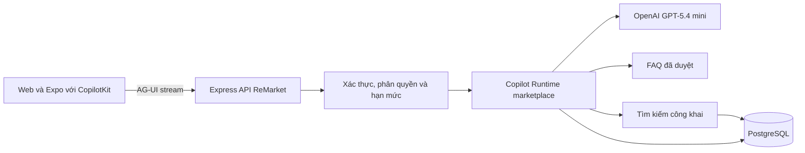

# Kế hoạch tích hợp AI cho ReMarket

Cập nhật ngày 16/11/2026. **CopilotKit cung cấp trợ lý cho người dùng marketplace.** ReMarket tự host Copilot Runtime trong Express API. GPT-5.4 mini là mô hình mặc định cho pilot và có thể đổi qua cấu hình backend. Thời gian, ngân sách và ngưỡng nghiệm thu là đề xuất để kiểm chứng khi triển khai.

## 1. Phạm vi và thứ tự bàn giao

| Mốc | Tính năng marketplace |
| --- | --- |
| MVP web | Chat tiếng Việt, hỏi đáp từ FAQ, tìm sản phẩm và chỉnh bộ lọc qua nhiều lượt. Thử nghiệm với tài khoản đã đăng nhập. |
| Sau pilot | Đưa chatbot lên Expo và cải thiện tìm kiếm tiếng Việt từ các truy vấn chưa đạt. |

## 2. Công nghệ được chọn

| Hạng mục | Lựa chọn | Cách áp dụng |
| --- | --- | --- |
| Copilot Runtime | **`@copilotkit/runtime`**, API `/v2` | Trong `@remarket/api`, dùng `CopilotRuntime`, `BuiltInAgent`, `defineTool` và adapter `createCopilotExpressHandler` từ `@copilotkit/runtime/v2/express`. Chạy runtime marketplace trong Express 4 hiện có. AG-UI truyền tin nhắn và kết quả tool qua stream. [Copilot Runtime](https://docs.copilotkit.ai/backend/copilot-runtime) · [Adapter Express](https://docs.copilotkit.ai/openai-agents-python/runtime-server-adapter) · [Server tools](https://docs.copilotkit.ai/server-tools) |
| Chat web | **`@copilotkit/react-core`**, API `/v2` | Dùng `CopilotKitProvider` và `CopilotPopup` trong marketplace. Dùng `useRenderTool` để hiển thị kết quả tìm kiếm bằng `ProductCard`. [React API v2](https://docs.copilotkit.ai/reference/v2) · [Render kết quả tool](https://docs.copilotkit.ai/reference/hooks/useRenderTool) |
| Chat Expo | **`@copilotkit/react-native/headless`** | Dùng `CopilotKitProvider`, `useAgent` và giao diện React Native của ReMarket. Chạy spike Metro, streaming, xác thực và hủy lượt trên Android/iOS. [React Native quickstart](https://docs.copilotkit.ai/react-native) |
| Nhà cung cấp mô hình | **OpenAI GPT-5.4 mini** | Dùng `openai:gpt-5.4-mini-2026-03-17` trong `BuiltInAgent`. Runtime gọi Responses API qua `ai` và `@ai-sdk/openai`. Chấm lại bộ mẫu khi đổi snapshot. [Cấu hình Built-in Agent](https://docs.copilotkit.ai/advanced-configuration) · [AI SDK OpenAI](https://ai-sdk.dev/providers/ai-sdk-providers/openai) · [GPT-5.4 mini](https://developers.openai.com/api/docs/models/gpt-5.4-mini) |
| Backend nghiệp vụ | **Express 4 + TypeScript + Zod** | Dùng middleware xác thực, phân quyền và rate limit hiện có. Kiểm tra phiên bản Zod thực tế trong lockfile. Căn chỉnh Zod lên **3.25.x** trong workspace dùng CopilotKit nếu cần, kiểm tra peer dependency trước khi pin phiên bản gói. [Manifest API](../apps/api/package.json) · [Router chính](../apps/api/src/app.ts) · [Yêu cầu SDK React Native](https://docs.copilotkit.ai/react-native) |
| Tìm sản phẩm | **PostgreSQL/Supabase + `searchPublicProducts`** | Mô hình diễn giải câu hỏi thành bộ lọc. Service tìm kiếm lấy dữ liệu trực tiếp từ catalog theo quyền hiện tại. [API sản phẩm](../apps/api/src/routes/products.ts) · [Service tìm kiếm](../apps/api/src/shared/product-search.ts) |
| Tri thức và lưu trữ | **JSON tiếng Việt trong Git, PostgreSQL + Prisma 5.22** | FAQ/quy định có mã mục và phiên bản, được review qua PR. Truy xuất mục phù hợp bằng từ khóa và bí danh tiếng Việt trong tập tài liệu nhỏ. Lưu phiên chat trong PostgreSQL. [Schema hiện tại](../apps/api/prisma/schema.prisma) |
| Giao diện nghiệp vụ | **React 19 + Vite** trên web, **Expo Router** trên mobile, **TanStack Query** ở cả hai | CopilotKit quản lý chat và stream. REST để tải thẻ sản phẩm dùng `packages/api-client` cùng DTO từ `packages/shared`. [Web](../apps/web/package.json) · [Expo](../apps/mobile/package.json) · [API client](../packages/api-client/package.json) |
| Kiểm thử và vận hành | **Vitest, Supertest, Testing Library, PostgreSQL cô lập** | Fake provider trong CI. Chạy bộ đánh giá mô hình thật trên staging với dữ liệu đã ẩn danh, giới hạn lượt gọi. Dùng Render và Supabase theo cấu hình triển khai đang có. [Kiểm tra trong repo](../README.md#kiểm-tra) · [Render](../render.yaml) |

Pin các gói CopilotKit cùng phiên bản đã qua spike. `/v2` là đường dẫn import của API. TypeScript runtime có thể tự host theo tài liệu CopilotKit, vì vậy ngân sách pilot tính nhà cung cấp mô hình và hạ tầng ReMarket đang chạy. FAQ ban đầu truy xuất theo từ khóa và bí danh. Chỉ đánh giá `pg_trgm` hoặc tìm kiếm lai với `pgvector` nếu số liệu pilot cho thấy cần cải thiện độ phủ. [Copilot Runtime tự host](https://docs.copilotkit.ai/backend/copilot-runtime)

## 3. Kiến trúc và API đề xuất

| Endpoint đề xuất | Đầu vào | Đầu ra và quyền |
| --- | --- | --- |
| `/api/v1/ai/copilotkit/*` | AG-UI do CopilotKit gửi | Runtime multi-route cho agent `marketplace`. Yêu cầu phiên đăng nhập hợp lệ. |
| `POST /api/v1/ai/threads`, `GET /api/v1/ai/threads/:id`, `DELETE /api/v1/ai/threads/:id` | Tạo phiên hoặc nhận mã phiên do server cấp | Cấp ID và quản lý lịch sử phiên của chính người dùng. |
| `POST /api/v1/ai/products/resolve` | Tối đa 6 ID từ kết quả tool | Trả `ProductListItem` từ DB cho các tin còn đủ điều kiện công khai, kèm URL ảnh được cấp tại thời điểm đọc. |

### Kết nối CopilotKit với phiên ReMarket

- Web và Expo truyền Bearer token hiện hành qua cấu hình provider. Đồng bộ token khi phiên làm mới và xóa trạng thái chat khi đổi tài khoản hoặc đăng xuất. `runtimeUrl` trỏ tới runtime marketplace, `agentId` là `marketplace` và `useSingleEndpoint={false}` cho multi-route. [Xác thực CopilotKit](https://docs.copilotkit.ai/auth) · [Provider và endpoint](https://docs.copilotkit.ai/backend/runtime-endpoints)
- Mount runtime sau middleware xác thực và phân quyền của Express. Căn `basePath` với đường dẫn adapter thực tế nhận được, tắt CORS riêng của adapter để dùng cấu hình của ReMarket và kiểm thử với `express.json` hiện có. Xác nhận stream hoạt động qua Vite proxy và đường dẫn triển khai Render hoặc Vercel đang dùng. [Adapter và routing](https://docs.copilotkit.ai/backend/runtime-endpoints) · [CORS hiện có](../apps/api/src/app.ts)
- Chỉ cho qua các route runtime cần cho client như `info`, `run`, `connect` và `stop` theo phiên bản đã pin. Kiểm tra chủ sở hữu, phạm vi và agent của `threadId` trước mọi thao tác liên quan đến phiên. Lịch sử đi qua REST của ReMarket. Các route mặc định có thể liệt kê hoặc xóa thread toàn runtime, nên chặn ở adapter. [Phạm vi route của runtime](https://docs.copilotkit.ai/backend/runtime-endpoints)
- Chuyển danh tính đã xác thực vào server tools bằng ngữ cảnh riêng của mỗi request trong Node.js, ưu tiên `AsyncLocalStorage` và kiểm chứng xuyên suốt streaming trong spike. Tool dừng nếu thiếu ngữ cảnh. `userId`, role, system prompt, tên tool và lịch sử đáng tin cậy do server quyết định từ phiên và dữ liệu lưu trữ. Chỉ nhận tin người dùng mới và tham số AG-UI cần thiết đã kiểm tra. [Server tools](https://docs.copilotkit.ai/server-tools) · [Mô hình xác thực ReMarket](../apps/api/src/app.ts)

### Chatbot người dùng

1. `CopilotKitProvider` gửi lượt chat đến runtime `marketplace`. API kiểm tra chủ phiên, độ dài và hạn mức, rồi nạp bộ lọc đã xác nhận và lịch sử gần nhất từ PostgreSQL.
2. Agent chọn server tool `search_products` hoặc `lookup_public_faq`. Prompt yêu cầu hỏi lại khi câu hỏi mơ hồ và chuyển hướng tới hỗ trợ khi thiếu nguồn. Tool tìm kiếm dùng schema Zod cho bản cập nhật gồm `q`, danh mục, tình trạng, tỉnh thành, giá, giao nhận và sắp xếp. Trường bị bỏ qua giữ giá trị cũ. `null` xóa bộ lọc.
3. `search_products` tra danh mục/tỉnh thành sang mã hợp lệ, kiểm tra enum và chuẩn hóa tiền VND theo logic dùng chung với `GET /products`. “Dưới 8 triệu” trở thành `max_price=7999999` vì bộ lọc giá mặc định là giới hạn bao gồm và VND là số nguyên. Với địa điểm mơ hồ hoặc khoảng giá sai, tool trả yêu cầu làm rõ trước khi truy vấn.
4. Tool gọi `searchPublicProducts` và trả số lượng, tối đa 6 ID cùng bộ lọc thực thi qua kết quả AG-UI. Renderer gọi `products/resolve` rồi dựng `ProductCard` và link “Xem tất cả”. Giá, ảnh và link chi tiết lấy từ API. Khi không có kết quả, renderer hiện bộ lọc đã áp dụng để người dùng chọn điều kiện muốn nới.
5. `lookup_public_faq` trả trích đoạn và mã mục từ bộ nội dung `public`. Agent tổng hợp trong giới hạn tối đa hai bước mô hình. Renderer dựng link từ danh sách nguồn đã duyệt và hiện `/support/new` nếu phù hợp. Kiểm tra nguồn đúng phạm vi khi tải lại lịch sử. [CopilotKit server tools](https://docs.copilotkit.ai/server-tools) · [Render kết quả tool](https://docs.copilotkit.ai/reference/hooks/useRenderTool)

Ví dụ “Tìm iPhone 13 dưới 8 triệu ở TP.HCM” lưu bộ lọc về mẫu máy, giá, tỉnh thành. “Chỉ lấy dưới 7 triệu” cập nhật giá. “Bỏ giới hạn địa điểm” xóa bộ lọc tỉnh thành. Tin chuyển sang trạng thái chờ duyệt, bị chặn hoặc đã bán sẽ bị loại khi tải lại kết quả cũ theo quy tắc tìm kiếm công khai. [Điều kiện hiển thị catalog](../apps/api/src/shared/product-search.ts)

## 4. Dữ liệu và cấu trúc mã nguồn

| Dữ liệu đề xuất | Nội dung và vòng đời |
| --- | --- |
| `AiThread` | Chủ sở hữu, bộ lọc hiện tại, `updatedAt`, `expiresAt`. TTL đề xuất 30 ngày kể từ lần dùng cuối. |
| `AiMessage` | `threadId`, vai trò, nội dung đã lọc, mã nguồn và ID sản phẩm tham chiếu. Dọn theo phiên, kể cả khi người dùng xóa tài khoản. Tạo chỉ mục theo phiên và thời điểm. |
| `AiRun` | Định danh request, nguồn gọi, trạng thái, số token vào/ra, độ trễ, mã lỗi, thời điểm. Dùng mã phiên và `runId` để xử lý retry và gom thống kê ngân sách. TTL đề xuất 90 ngày cho metadata vận hành. |
| FAQ và chính sách | JSON có `id`, `audience`, câu hỏi/chủ đề, bí danh tiếng Việt, nội dung, link nội bộ, phiên bản và ngày hiệu lực. Duyệt bộ nguồn qua PR. Chọn các mục công khai trước khi tạo ngữ cảnh. |

Đặt cấu hình Copilot Runtime, agent và tools trong `apps/api/src/services/ai/`. Đặt route trong `routes/ai.ts`, client REST trong `packages/api-client/src/ai.ts` và DTO trong `packages/shared`. Trên web, gắn provider vào khu vực marketplace. Trong Expo, dùng cùng runtime và REST contract qua provider native. Dùng Prisma migration bổ sung bảng và job retention hiện có để dọn dữ liệu AI. [Job retention](../apps/api/src/jobs/retention.ts)

PostgreSQL là nguồn lưu lịch sử lâu dài. Nạp lịch sử đã lọc khi tạo lượt mới. Dùng hook hoặc `AgentRunner` của runtime để lưu nội dung đã chuẩn hóa từ lượt hoàn tất. Chốt điểm tích hợp trong spike bằng kiểm thử gửi nhiều lượt, restart rồi mở lại chat. `InMemoryAgentRunner` phù hợp để thử stream ban đầu, vòng đời run và reconnect ngắn trong tiến trình. Kiểm thử thao tác dọn/xóa với runner được chọn trước pilot. [AgentRunner và lưu trạng thái](https://docs.copilotkit.ai/backend/agent-runner)

Dùng `runId` của AG-UI cho lượt chat. API đối chiếu payload khi nhận lại cùng ID và trả trạng thái đang xử lý hoặc lịch sử đã lưu. Lease có thời hạn giúp phục hồi lượt gián đoạn. Chỉ run còn giữ lease được ghi kết quả và cập nhật bộ lọc. Mỗi phiên xử lý một lượt mới tại một thời điểm. Gọi mô hình bên ngoài transaction. Retry sau khi tiến trình dừng đột ngột có thể phát sinh thêm chi phí gọi mô hình.

## 5. Cấu hình, dữ liệu gửi mô hình và chi phí

- Cấu hình đề xuất gồm `AI_USER_CHAT_ENABLED`, `OPENAI_API_KEY`, `AI_MODEL`, `AI_REQUEST_TIMEOUT_MS` và `AI_DAILY_BUDGET_USD`. Cờ tính năng mặc định tắt. Đặt key trong secret store của API, tách staging và production. URL runtime lấy từ API base URL hiện có. [Cấu hình API](../apps/api/src/config/env.ts) · [Mẫu môi trường](../.env.example)
- Giới hạn đo pilot gồm 1.200 ký tự/lượt, 6 lượt gần nhất trong ngữ cảnh, `maxSteps: 2`, giới hạn token đầu ra và timeout tổng 12 giây. Tắt retry tự động của agent trong pilot để kiểm soát ngân sách, cho phép người dùng chủ động thử lại. Đặt quota riêng theo user/IP và mức đồng thời toàn dịch vụ. Giữ trước chi phí tối đa của run theo ngân sách token và số bước, rồi đối soát theo usage. Xác nhận chỗ lấy token usage và khả năng hủy upstream trong spike. Khi chạm quota hoặc timeout, hiện lỗi và đường dẫn tới tìm kiếm hoặc hỗ trợ. [Cấu hình bước và token của agent](https://docs.copilotkit.ai/advanced-configuration)
- Chỉ đưa vào prompt các trường nghiệp vụ cần thiết. Che email, số điện thoại, địa chỉ chi tiết trong văn bản tự do trước khi gửi. Log giữ token usage, request ID, lỗi và thời gian xử lý. Các thao tác đọc chạy từ ứng dụng theo danh sách cho phép, kiểm tra lại quyền và tham số bằng code. Nội dung chat và tin đăng được xử lý như dữ liệu đầu vào. Render câu trả lời dưới dạng văn bản đã escape, link dựng từ nguồn đã xác thực.
- Đặt `providerOptions.openai.store: false` trong cấu hình agent. Kiểm tra trên staging rằng request tới OpenAI đi qua Responses API với tùy chọn đã áp dụng. OpenAI mô tả log giám sát lạm dụng mặc định có thể được lưu tới 30 ngày. Xác nhận cấu hình project và phạm vi dữ liệu được gửi trước khi mở pilot với dữ liệu thật. [CopilotKit provider options](https://docs.copilotkit.ai/advanced-configuration) · [AI SDK OpenAI](https://ai-sdk.dev/providers/ai-sdk-providers/openai) · [Kiểm soát dữ liệu OpenAI](https://developers.openai.com/api/docs/guides/your-data)
- Giá tham chiếu GPT-5.4 mini tại thời điểm lập kế hoạch là **0,75 USD/triệu token đầu vào** và **4,50 USD/triệu token đầu ra** theo giá chuẩn, chưa tính cached input. Ví dụ 10.000 lượt/tháng, trung bình tổng cộng 2.000 token vào và 300 token ra mỗi lượt, phần văn bản ước **28,50 USD/tháng**. Bao gồm token của mọi lần gọi trong số liệu đo thực tế. Ảnh, hạ tầng, thuế và chênh lệch khối lượng có thể làm chi phí thực tế tăng. [Giá mô hình](https://developers.openai.com/api/docs/models/gpt-5.4-mini#pricing)

## 6. Backlog và ước lượng

Ước lượng cho một dev full-stack làm toàn thời gian, có người hỗ trợ chuẩn bị FAQ và chấm mẫu. Thời gian phát hành phụ thuộc vào việc chốt chính sách và kết quả pilot.

| Giai đoạn | Ước lượng | Việc cần làm và điều kiện bàn giao |
| --- | --- | --- |
| **0. Spike CopilotKit và nguồn dữ liệu** | 3–4 ngày | Pin gói sau khi thử Node 22, Express 4, React 19/Vite và Zod. Chạy một agent có tool, stream qua proxy, kiểm tra ngữ cảnh phiên khi có hai tài khoản, token usage, timeout và đường lưu/replay lịch sử. Chuẩn bị FAQ, chính sách và mẫu tiếng Việt. |
| **1. Chatbot người dùng trên web** | 6–8 ngày | Mount runtime `marketplace`, triển khai bảng phiên, server tools, `CopilotPopup` và thẻ sản phẩm từ `useRenderTool`. Nghiệm thu tìm kiếm nhiều lượt, FAQ có nguồn, mở lại/xóa phiên và fallback khi stream lỗi. |
| **2. Pilot web** | 3–5 ngày | Chạy CI và bộ đánh giá staging, review mẫu và bật trợ lý cho nhóm thử nghiệm. Đo chất lượng, chi phí, lỗi và độ trễ. Diễn tập tắt tính năng AI. |
| **3. Expo và cải tiến** | 4–7 ngày cho Expo | Tích hợp `@copilotkit/react-native/headless` vào marketplace. Kiểm tra build Expo và Metro, môi trường streaming/polyfill, làm mới token, hủy lượt, mạng gián đoạn và deep link trên iOS/Android. Chốt cải tiến tìm kiếm từ kết quả pilot. |

Tổng ước lượng **12–17 ngày công cho MVP web và đợt pilot**, thêm **4–7 ngày công cho Expo** khi runtime ổn định. Mở rộng tìm kiếm được ước lượng riêng sau pilot.

## 7. Nghiệm thu và phát hành

| Nhóm kiểm thử | Tiêu chí MVP đề xuất |
| --- | --- |
| Tìm kiếm | Kiểm tra ít nhất 50 ca gồm giá VND, tỉnh thành, từ không dấu, chỉnh bộ lọc qua nhiều lượt, kết quả rỗng và tin vừa đổi trạng thái. ≥ 90% ca trích đúng bộ lọc hoặc hỏi lại đúng khi mơ hồ. Mọi thẻ sản phẩm trong các ca kiểm thử đều lấy từ dữ liệu đủ điều kiện hiển thị. |
| FAQ | Ít nhất 30 ca gồm câu có nguồn, thiếu nguồn và yêu cầu hiện thông tin nội bộ. ≥ 90% ca có câu trả lời đúng nguồn hoặc chuyển hướng phù hợp. Mọi nguồn hiển thị đều có mã hợp lệ và đúng phạm vi. |
| Phân quyền và trạng thái | Hai tài khoản đồng thời chỉ nhận stream và lịch sử của mình, kể cả khi truyền `threadId` sai chủ, reconnect hoặc gọi `stop`. Kiểm tra chặn các route quản lý thread mặc định và thao tác qua tool. |
| Vận hành | Đo thời gian đến sự kiện đầu tiên và p50/p95 toàn lượt theo tìm kiếm và FAQ. Mục tiêu thử nghiệm p95 ≤ 8 giây cho chat khi instance đã khởi động. Kiểm tra stream bị ngắt, reconnect, reload sau restart, xóa phiên, token hết hạn và fallback khi mô hình lỗi hoặc tắt cờ. Theo dõi timeout, `429`, lỗi schema, token, chi phí và cold start. |

Trình tự phát hành là chạy migration cộng thêm trên staging, chạy `pnpm test`, `pnpm typecheck`, `pnpm lint`, `pnpm build` và integration PostgreSQL cô lập, sau đó kiểm tra với dữ liệu ẩn danh trên staging. Bật chatbot cho nhóm tài khoản pilot. Có thể tắt cờ tính năng để ngừng gọi AI khi chất lượng hoặc chi phí vượt ngưỡng. Các luồng nghiệp vụ đi qua API hiện có có thể tiếp tục sử dụng. [Quy trình kiểm tra repo](../README.md#kiểm-tra) · [Runbook backend](backend-runbook.md)
